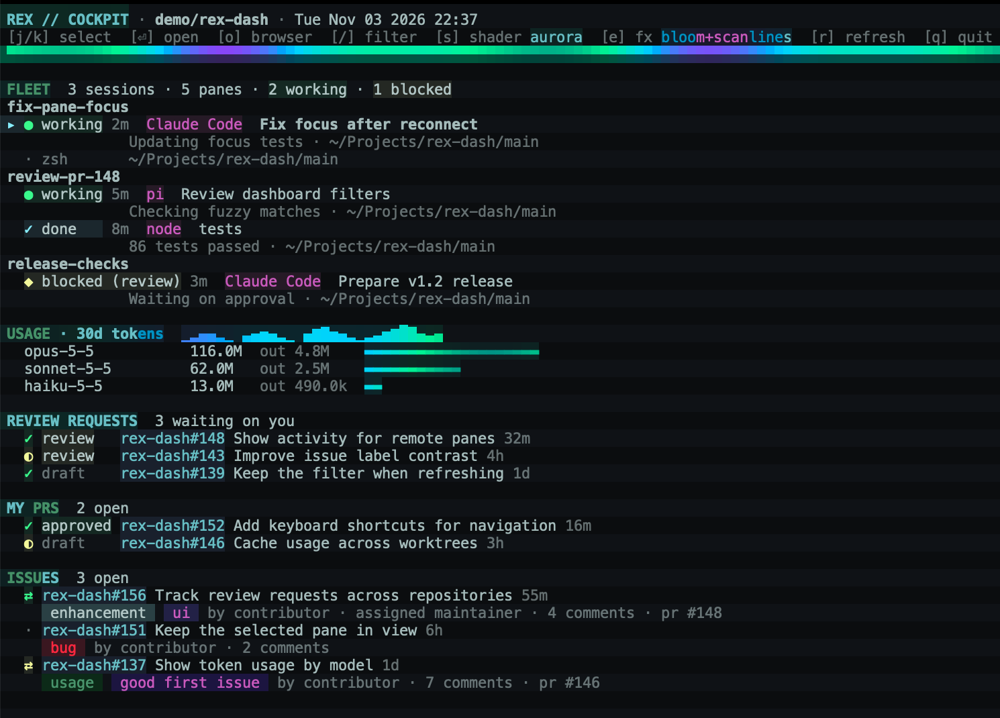

# rex-dash

A dashboard pane for [Rex](https://www.superlogical.com/rex/docs).



*Dashboard in Rex with sample data.*

It shows:

- **Fleet:** every Rex session and pane, with the status its program reports to Rex (working, blocked, done or idle), the task title, current activity and folder. Claude Code and omp report status; plain shells show dimmed.
- **Usage:** Claude Code tokens by model over the last 30 days, with a daily sparkline, read from `~/.claude/projects`.
- **Review requests:** up to 10 open PRs waiting on your review, across GitHub, with CI and review state.
- **My PRs:** up to 10 of your open PRs, with CI, review and draft state.
- **Issues:** open issues assigned to you, most recently updated first. Each shows its labels in their GitHub colours, then its author, assignees, comment count, milestone and linked PRs. A `⇄` marks an issue with a linked PR, one that would close it, coloured by the most active one: green open, yellow draft, magenta merged, dim closed.

Keys: `j`/`k` or the arrow keys select an agent, a PR or an issue, scrolling the dashboard to keep the selection in view; `/` filters the lists; `s` cycles the shader, `e` cycles the effects, `r` refreshes, `q` quits. Enter on an agent shows its pane in the Rex app. Enter on a PR or an issue opens a worktree for it. `o` on a PR or an issue opens its GitHub page in your browser, with `open` on macOS or `xdg-open` elsewhere. That's on the machine rex-dash runs on, so on a remote Rex server it opens there.

## Filtering

`/` starts a fuzzy filter, like [fzf](https://github.com/junegunn/fzf). As you type, the fleet, review requests, my PRs and issues keep only the items that match, in their usual order, with the matched characters underlined. Each heading counts its matches. Usage isn't filtered.

- An item matches when the query's characters appear in its text in order, though not necessarily together: `fxlg` matches "fix login". An item's text is what its rows show. A pane's text also includes its session's name.
- Spaces separate terms. An item must match every term, in any order.
- A term with a capital letter matches case. Otherwise case doesn't matter.
- While you type, the selection goes to the best match. Characters next to each other and at the start of words count most.

While you type, letters go into the query, so keys such as `q` and `j` don't act. These keys work:

| Key | Action |
| --- | --- |
| Enter | Keep the filter and go back to the usual keys, so `j`/`k` select among the matches |
| Esc or Ctrl-C | Clear the filter |
| ↑/↓, Ctrl-N/Ctrl-P | Select |
| Backspace, Ctrl-W, Ctrl-U | Delete a character, a word or the whole query. Backspace on an empty query stops filtering |

After Enter, `/` edits the filter and Esc clears it. PRs and issues are filtered from what the dashboard fetched, which is up to 30 of each.

## Opening a worktree for a PR or an issue

Enter on a PR or an issue runs [wt](https://github.com/gugahoi/wt) in the repo, which applies its usual rules:

- **PR:** `wt pr <number>` switches to the PR's branch. If there's no local branch yet, wt fetches it from GitHub. A PR from a fork is fetched as `pr-<number>`.
- **Issue:** `wt issue <number>` offers the issue's existing `<number>-*` branches, or a new branch named in a prompt that's prefilled from the issue's title.

Then wt creates the worktree, runs `wt.setupCommand`, and opens the worktree in its own session (in Rex, inside Rex) with wt's `default_command`. While wt runs, it has the dashboard's pane. When wt finishes, the dashboard comes back. If wt fails, its messages stay on screen until you press a key.

You can select only the PRs on screen, up to 10 in each list. To reach others, filter for them.

This needs repo mode, since wt works on the repo it runs in.

## Repo mode

Started inside a git repo, the dashboard shows only that repo, and its name appears in the header:

- **Fleet:** panes whose working folder is in one of the repo's worktrees. In the bare-plus-worktrees layout (`<dir>/.bare`), anything under `<dir>` counts.
- **PRs:** only PRs in the repo's GitHub repository, the one `gh` would use. A repo without a GitHub remote shows no PRs or issues.
- **Issues:** every open issue in that GitHub repository, not just yours.
- **Usage:** only Claude Code sessions started in the repo's folders.

Started anywhere else, such as your home folder, it shows everything.

## Cache

The dashboard caches what it shows, so a new dashboard opens straight on the last data and refreshes it in the background. Until every section has refreshed, the header shows how old the oldest cached section is, such as `cached 4m`.

Each repo has its own cache, shared by all its worktrees. Everything, outside a repo, has its own as well. Caches live in `$XDG_CACHE_HOME/rex-dash`, or `~/.cache/rex-dash`, one folder per repo:

- `state.json`: the last fleet, PRs, issues and usage, and the repo's GitHub name. The cached name is used straight away and checked against `gh` in the background. If it changed, PRs and issues are fetched again.
- `transcripts.json`: the token usage read from each Claude Code transcript, limited to the repo and the last 30 days. Only transcripts that changed since are read again. Adding a worktree outside the repo's folders means reading them all once more.

`--once` always fetches fresh data, but it still uses the transcripts and the GitHub name. You can delete the folder at any time; the next start just takes longer.

## Effects

Everything is drawn with truecolor text, at 10 frames a second, rewriting only rows that changed.

- **Shaders** (`s`): `aurora`, `plasma`, `ember` or `off`. The shader animates the bands at the top and bottom, the headings and the usage charts.
- **Effects** (`e`): `bloom+scanlines`, `bloom`, `scanlines` or `off`. Bloom puts a soft glow behind coloured text. Scanlines darken every other row and paint the pane's background, replacing your terminal theme's background.

Both start at `aurora` and `bloom+scanlines`. The dashboard remembers the last ones you picked, for every dashboard in every repo, in `$XDG_STATE_HOME/rex-dash/settings.json` (`~/.local/state/rex-dash/settings.json`). That's apart from the cache, so deleting the cache keeps them. `--once` always prints without them.

## Requirements

- `rex` on `PATH`
- `gh`, logged in (`gh auth login`)
- `git` for repo mode
- [`wt`](https://github.com/gugahoi/wt) 1.5.0 or later, to open worktrees for PRs and issues (`brew install gugahoi/tap/wt`). With 1.4.0, issues work, but Enter on a PR opens wt's PR picker instead
- Node 20.1 or later **only** when running from a source checkout, not for the release binary

## Install

```sh
brew install gugahoi/tap/rex-dash
```

Homebrew installs `gh`, but not Node. `rex` comes with the Rex app. The formula installs a single executable with Node embedded; no `lib/` directory is required.

Alternatively, download the `rex-dash-vX.Y.Z-<platform>.tar.gz` archive for your OS and architecture from the [GitHub Releases](https://github.com/gugahoi/rex-dash/releases) page (`darwin-arm64`, `darwin-x64`, `linux-arm64` or `linux-x64`). Check it against its `.sha256` asset, extract it, and put the `rex-dash` executable on your `PATH`. The archive also includes the project and embedded Node runtime licenses.

macOS binaries are ad-hoc signed, **not notarized**. If Gatekeeper blocks a downloaded binary, first verify its checksum and source; then, if you trust it, remove quarantine from that binary with `xattr -d com.apple.quarantine /path/to/rex-dash`. This is a manual fallback, not an automatic installation step.

To run from source instead, clone the repository and symlink its entry point onto your `PATH`:

```sh
ln -s "$PWD/rex-dash" ~/.local/bin/rex-dash
```

Keep `lib/` beside `rex-dash` in the clone; copying the source entry point alone will not work. This route needs Node 20.1 or later.

Open it beside your current pane. It starts in that pane's folder, so inside a repo it shows only that repo. Add `-c ~` to see everything:

```sh
rex split -b "$REX_BLOCK" --split=right --ratio 45 --label Cockpit --focus=false -- rex-dash
```

With several Rex apps connected, set `REX_CLIENT` to the one Enter should switch.

## Usage

```
rex-dash          live dashboard
rex-dash --once   print one frame and exit
rex-dash --test   run the self-check
```

The fleet refreshes every 3 seconds, PRs and issues every minute and usage every 5 minutes.

## Development

The source executable is a small entry point. `lib/app.js` owns dashboard state and refreshes; `lib/integrations/` calls Rex, GitHub and wt; `lib/storage.js` and `lib/usage.js` manage persisted data; and `lib/ui/` handles the terminal view and input. There is no runtime npm dependency. The release build uses Node 24, esbuild and postject **at build time** to bundle those modules into a single executable containing Node.

```sh
./rex-dash --test                      # source self-check
node --test test/*.test.js              # full suite, including mocked CLI commands
npm ci                                  # install pinned build-only dependencies (Node 24)
./scripts/build-binary.sh v0.0.0 dist   # build for this machine's OS and architecture
./scripts/test-binary.sh dist/rex-dash  # smoke-test without Node on PATH or lib/
./scripts/test-package.sh              # build archive and validate formula
```

CI builds and tests all four native targets. It also installs and tests the generated formula on macOS with `./scripts/test-package.sh --brew`; this refuses to replace an existing `rex-dash` installation. The local formula test duplicates the host archive under other target names to test formula generation, but runs only the host binary.

## Releasing

```sh
git tag vX.Y.Z && git push origin vX.Y.Z
```

Or run the Release workflow from the Actions tab with an **existing, pushed** tag. It builds and tests macOS and Linux binaries for arm64 and x64 from that tag before publishing. The GitHub Release contains four archives and their SHA-256 files; only after upload does the workflow write the binary-based `Formula/rex-dash.rb` in [gugahoi/homebrew-tap](https://github.com/gugahoi/homebrew-tap) with `scripts/write-formula.sh`. Reruns refuse to overwrite a published asset if its bytes differ.
