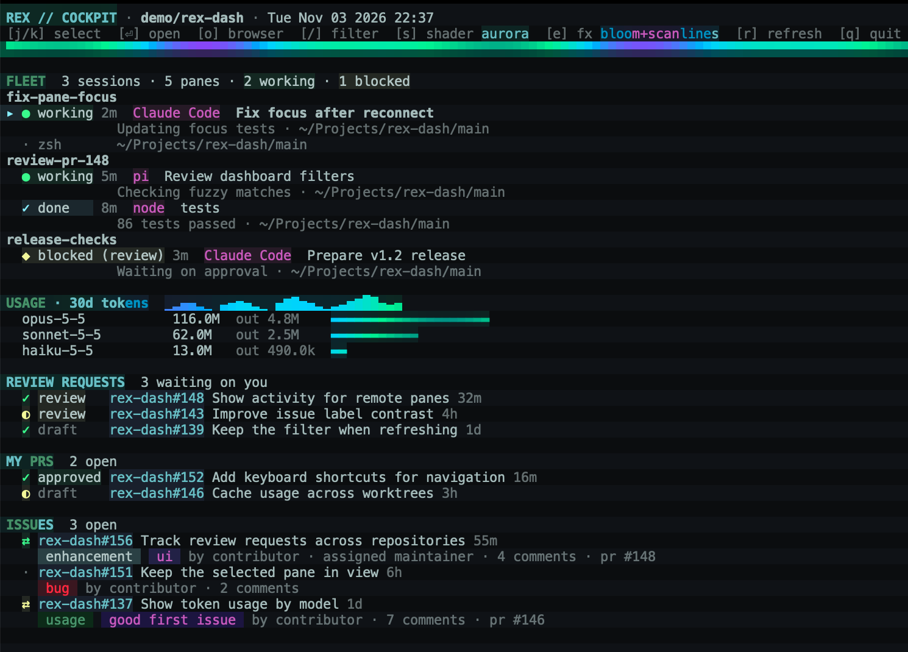

# rex-dash

A dashboard pane for [Rex](https://www.superlogical.com/rex/docs).



*Dashboard in Rex with sample data.*

It shows:

- **Fleet:** every Rex session and pane but the dashboard's own, with the status its program reports to Rex (working, blocked, done or idle), the task title, current activity and folder. Claude Code and omp report status; plain shells show dimmed.
- **Usage:** Claude Code tokens by model over the last 30 days, with a daily sparkline, read from `~/.claude/projects`.
- **Review requests:** up to 10 open PRs waiting on your review, across GitHub, with CI and review state.
- **My PRs:** up to 10 of your open PRs, with CI, review and draft state. A yellow `↩2` means two replies are waiting on you. Those PRs come first, and the heading counts them. See [Replies](#replies).
- **Issues:** open issues assigned to you, most recently updated first. Each shows its labels in their GitHub colours, then its author, assignees, comment count, milestone and linked PRs. A `⇄` marks an issue with a linked PR, one that would close it, coloured by the most active one: green open, yellow draft, magenta merged, dim closed.

Keys: `j`/`k` or the arrow keys select an agent, a PR or an issue; Ctrl-D and Ctrl-U move the selection half a screen, Ctrl-F and Ctrl-B (or Page Down and Page Up) a screen, and Home and End go to the first or the last. As in Vim, those keys scroll the lists, and `j`/`k` scroll them only when the selection would leave the screen; `l` or → opens the selected PR's or issue's page in the dashboard, with a PR's unresolved review threads and an issue's text (see [PR and issue pages](#pr-and-issue-pages)); `/` filters the lists; `1` to `5` hide and show the sections (see [Hiding sections](#hiding-sections)); `s` cycles the shader, `e` cycles the effects, `r` refreshes, `q` quits. Enter on an agent shows its pane in the Rex app. Enter on a PR or an issue opens a worktree for it. `o` on a PR or an issue opens its GitHub page in your browser, with `open` on macOS or `xdg-open` elsewhere. That's on the machine rex-dash runs on, so on a remote Rex server it opens there. Keys you add yourself run your own commands on a PR or an issue, such as starting an agent on it: see [Custom keys](#custom-keys).

## Filtering

`/` starts a fuzzy filter, like [fzf](https://github.com/junegunn/fzf). As you type, the fleet, review requests, my PRs and issues keep only the items that match, in their usual order, with the matched characters underlined. Each heading counts its matches. Usage isn't filtered.

- An item matches when the query's characters appear in its text in order, though not necessarily together: `fxlg` matches "fix login". An item's text is what its rows show. A pane's text also includes its session's name.
- Spaces separate terms. An item must match every term, in any order.
- A term with a capital letter matches case. Otherwise case doesn't matter.
- While you type, the selection goes to the best match. Characters next to each other and at the start of words count most.

While you type, letters go into the query, so keys such as `q` and `j` don't act. These keys work:

| Key | Action |
| --- | --- |
| Enter | Keep the filter and go back to the usual keys, so `j`/`k` select among the matches |
| → | Keep the filter, and open the selected PR's or issue's [page](#pr-and-issue-pages) |
| Esc or Ctrl-C | Clear the filter |
| ↑/↓, Ctrl-N/Ctrl-P | Select |
| Backspace, Ctrl-W, Ctrl-U | Delete a character, a word or the whole query. Backspace on an empty query stops filtering |

After Enter, `/` edits the filter and Esc clears it. PRs and issues are filtered from what the dashboard fetched, which is up to 30 of each.

`/reply` keeps your PRs that have replies waiting on you. Since the filter is fuzzy, it also keeps any PR whose text has those letters in order.

## Hiding sections

Each section has a number key, in screen order, that hides it and shows it again:

| Key | Section | In `hide` |
| --- | --- | --- |
| `1` | Fleet | `fleet` |
| `2` | Usage | `usage` |
| `3` | Review requests | `review_requests` |
| `4` | My PRs | `my_prs` |
| `5` | Issues | `issues` |

The keys last until you quit. While sections are hidden, the header lists them with their keys, such as `hidden [2] usage [5] issues`. To hide sections every time, list them in `hide` in `$XDG_CONFIG_HOME/rex-dash/config.json`, or `~/.config/rex-dash/config.json`:

```json
{
  "hide": ["usage", "issues"]
}
```

The keys still show them for the session. `--once` leaves them out too. `r` reads the file again. Then a section whose entry in `hide` changed takes the file's word, and the others stay as your keys left them.

A hidden section isn't fetched, so it costs nothing. Hiding usage skips the scan of Claude Code's transcripts, and hiding both review requests and my PRs skips the PR query. A section you show again is fetched at once. Until then it shows its cached data, and the header shows how old that is. j/k select only what shows, and the filter only looks through it.

## Replies

A reply waits on you in one of your PRs when either:

- a review thread is unresolved and someone else wrote its last comment, or
- someone else commented, requested changes or left a review comment after your last comment, review or commit.

Each counts once in the `↩` number. Replying in the thread, or resolving it, clears a thread. Commenting or pushing clears the rest. Bots, such as Copilot and Claude, don't count. Approvals don't count either. A review with inline comments counts through its threads.

The dashboard reads the last 20 threads, 10 reviews and 10 comments of each PR. That makes its PR query cost about 8 points of GitHub's 5,000 an hour, rather than 1. It runs every minute in every open dashboard, unless both review requests and my PRs are [hidden](#hiding-sections).

While replies wait on you, Rex shows the dashboard's pane as blocked, waiting on you, with a message such as "2 PRs need your reply". Then you can see it in Rex's sidebar when the dashboard is out of sight. While my PRs is [hidden](#hiding-sections), it doesn't.

## PR and issue pages

`l` or → on a PR or an issue shows its page in place of the lists, to read without leaving the dashboard.

A PR's page shows:

- its state, review decision, author, branches, size and checks, naming the ones that fail;
- its **unresolved review threads**, each with its file and line, the last lines of the diff it's on, and every comment. A yellow `↩` marks a thread that waits on you, as in [Replies](#replies): someone else, not a bot, has the last word, in your PR or in a thread you wrote in. Those come first. Resolved threads aren't shown, but the heading counts them;
- its description;
- its conversation: the latest comments and reviews, oldest first. In your PR, a `↩` marks the ones that came after your last comment, review or commit.

An issue's page shows its state, author, assignees, milestone, labels and linked PRs, then its **text**, then its latest comments.

The text is Markdown, shown much as written, wrapped to the pane: headings are bold, and quotes and code blocks dim. HTML comments, such as a template's hints, and the usual HTML tags are left out, and images show as `[image]`. A long comment shows its first lines, then says how many more there are: `o` opens the page in your browser.

On a page:

| Key | Action |
| --- | --- |
| ←, Esc or Backspace | Go back to the lists, with the same selection |
| `j`/`k` or ↓/↑ | Scroll a line |
| Space or Ctrl-F, Ctrl-B | Scroll a screen down or up. Page Down and Page Up too |
| Ctrl-D, Ctrl-U | Scroll half a screen |
| Home, End | Go to the top or the bottom |
| Enter, `o`, your keys | As in the lists: open a worktree, the browser, or run your command, for this PR or issue |
| `r` | Refresh the page, and the dashboard |

The key bar shows which lines are on screen, such as `scroll 1-20 of 154`. The page is fetched from GitHub when it opens, on `r`, and every minute while it shows. A page you opened before shows at once, while it's fetched again. It costs about 2 points of GitHub's 5,000 an hour, and reads the first 100 review threads, with 30 comments each, and the latest 20 comments and reviews of a PR, or 30 comments of an issue. Pages aren't cached on disk.

## Opening a worktree for a PR or an issue

Enter on a PR or an issue runs [wt](https://github.com/gugahoi/wt) in the repo, which applies its usual rules:

- **PR:** `wt pr <number>` switches to the PR's branch. If there's no local branch yet, wt fetches it from GitHub. A PR from a fork is fetched as `pr-<number>`.
- **Issue:** `wt issue <number>` offers the issue's existing `<number>-*` branches, or a new branch named in a prompt that's prefilled from the issue's title.

Then wt creates the worktree, runs `wt.setupCommand`, and opens the worktree in its own session (in Rex, inside Rex) with wt's `default_command`. While wt runs, it has the dashboard's pane. When wt finishes, the dashboard comes back. If wt fails, its messages stay on screen until you press a key.

You can select only the PRs on screen, up to 10 in each list. To reach others, filter for them.

This needs repo mode, since wt works on the repo it runs in.

## Custom keys

You can add keys of your own in `$XDG_CONFIG_HOME/rex-dash/config.json`, or `~/.config/rex-dash/config.json`. A key runs a command for the selected PR or issue, in its worktree, in a new tab. For example, `a` starts an agent on it, and `R` reviews a PR:

```json
{
  "keymaps": {
    "a": {
      "label": "agent",
      "command": {
        "issue": "claude \"Implement issue #$REX_DASH_NUMBER, $REX_DASH_TITLE. Read it with gh issue view $REX_DASH_NUMBER.\"",
        "pr": "claude \"Address the review comments on PR #$REX_DASH_NUMBER. Read them with gh pr view $REX_DASH_NUMBER --comments.\""
      }
    },
    "R": { "label": "review", "on": ["pr"], "command": "claude -p \"/review $REX_DASH_NUMBER\"" }
  }
}
```

The key first opens the worktree with wt, as Enter does, so wt has the dashboard's pane while it asks for a branch and runs `wt.setupCommand`. Then, instead of switching to the worktree, rex-dash runs the command in a new tab in the worktree's session, the one Enter opens, and creates that session if there's none. The tab opens in the background: you stay on the dashboard. An agent that reports its status to Rex, such as Claude Code, shows up in the fleet, where Enter takes you to it. `claude "…"` stays open so you can follow up; `claude -p "…"` prints its answer and exits.

Each key has:

| Field | |
| --- | --- |
| `command` | Required. A command for `/bin/sh -c`, or one for each kind: `{"issue": "…", "pr": "…"}` |
| `label` | Its name in the key bar and in its tabs' names, such as `agent #42`. The command's first word by default |
| `on` | `["issue"]`, `["pr"]` or both. The kinds `command` has by default |
| `background` | `false` switches to the tab, as Enter does. `true` by default |
| `keep_open` | `false` closes the tab when the command exits. `true` by default, so you can read what it printed |
| `session` | `"current"` opens the tab in the dashboard's session rather than the worktree's. `"worktree"` by default |

The command gets the PR or issue, and its worktree, in variables:

| Variable | |
| --- | --- |
| `REX_DASH_KIND` | `issue` or `pr` |
| `REX_DASH_NUMBER` | Its number |
| `REX_DASH_TITLE` | Its title |
| `REX_DASH_URL` | Its GitHub page |
| `REX_DASH_REPO` | The GitHub repository, such as `owner/repo` |
| `WT_WORKTREE`, `WT_BRANCH` | The worktree's folder and branch |

Use them, in double quotes, rather than putting their text in the command. Anyone can write an issue's title, and in `"$REX_DASH_TITLE"` it stays text, never a command. The command runs where Rex runs commands, in your login shell's environment, so your `PATH` applies but your aliases don't.

A key is a single character, and case matters: `a` and `A` are different keys. The dashboard's own keys can't be mapped: `j`, `k`, `l`, `o`, `q`, `r`, `s`, `e`, `/` and `1` to `5`. Your keys work on a [PR's or issue's page](#pr-and-issue-pages) too, for that PR or issue. A key that's wrong is left out, and the header says why. `r` reads the file again, so you can try a change without restarting. Like Enter, your keys need repo mode.

## Repo mode

Started inside a git repo, the dashboard shows only that repo, and its name appears in the header:

- **Fleet:** panes whose working folder is in one of the repo's worktrees. In the bare-plus-worktrees layout (`<dir>/.bare`), anything under `<dir>` counts.
- **PRs:** only PRs in the repo's GitHub repository, the one `gh` would use. A repo without a GitHub remote shows no PRs or issues.
- **Issues:** every open issue in that GitHub repository, not just yours.
- **Usage:** only Claude Code sessions started in the repo's folders.

Started anywhere else, such as your home folder, it shows everything.

## Cache

The dashboard caches what it shows, so a new dashboard opens straight on the last data and refreshes it in the background. Until every section on screen has refreshed, the header shows how old the oldest cached section is, such as `cached 4m`.

Each repo has its own cache, shared by all its worktrees. Everything, outside a repo, has its own as well. Caches live in `$XDG_CACHE_HOME/rex-dash`, or `~/.cache/rex-dash`, one folder per repo:

- `state.json`: the last fleet, PRs, issues and usage, and the repo's GitHub name. The cached name is used straight away and checked against `gh` in the background. If it changed, PRs and issues are fetched again.
- `transcripts.json`: the token usage read from each Claude Code transcript, limited to the repo and the last 30 days. Only transcripts that changed since are read again. Adding a worktree outside the repo's folders means reading them all once more.

`--once` always fetches fresh data, but it still uses the transcripts and the GitHub name. You can delete the folder at any time; the next start just takes longer.

## Effects

Everything is drawn with truecolor text, at 10 frames a second, rewriting only rows that changed.

- **Shaders** (`s`): `aurora`, `plasma`, `ember` or `off`. The shader animates the bands at the top and bottom, the headings and the usage charts.
- **Effects** (`e`): `bloom+scanlines`, `bloom`, `scanlines` or `off`. Bloom puts a soft glow behind coloured text. Scanlines darken every other row and paint the pane's background, replacing your terminal theme's background.

Both start at `aurora` and `bloom+scanlines`. The dashboard remembers the last ones you picked, for every dashboard in every repo, in `$XDG_STATE_HOME/rex-dash/settings.json` (`~/.local/state/rex-dash/settings.json`). That's apart from the cache, so deleting the cache keeps them. `--once` always prints without them.

## Requirements

- `rex` on `PATH`
- `gh`, logged in (`gh auth login`)
- `git` for repo mode
- [`wt`](https://github.com/gugahoi/wt) 1.5.0 or later, to open worktrees for PRs and issues (`brew install gugahoi/tap/wt`). With 1.4.0, issues work, but Enter on a PR opens wt's PR picker instead
- Node 20.1 or later **only** when running from a source checkout, not for the release binary

## Install

```sh
brew install gugahoi/tap/rex-dash
```

Homebrew installs `gh`, but not Node. `rex` comes with the Rex app. The formula installs a single executable with Node embedded; no `lib/` directory is required.

Alternatively, download the `rex-dash-vX.Y.Z-<platform>.tar.gz` archive for your OS and architecture from the [GitHub Releases](https://github.com/gugahoi/rex-dash/releases) page (`darwin-arm64`, `darwin-x64`, `linux-arm64` or `linux-x64`). Check it against its `.sha256` asset, extract it, and put the `rex-dash` executable on your `PATH`. The archive also includes the project and embedded Node runtime licenses.

macOS binaries are ad-hoc signed, **not notarized**. If Gatekeeper blocks a downloaded binary, first verify its checksum and source; then, if you trust it, remove quarantine from that binary with `xattr -d com.apple.quarantine /path/to/rex-dash`. This is a manual fallback, not an automatic installation step.

To run from source instead, clone the repository and symlink its entry point onto your `PATH`:

```sh
ln -s "$PWD/rex-dash" ~/.local/bin/rex-dash
```

Keep `lib/` beside `rex-dash` in the clone; copying the source entry point alone will not work. This route needs Node 20.1 or later.

Open it beside your current pane. It starts in that pane's folder, so inside a repo it shows only that repo. Add `-c ~` to see everything:

```sh
rex split -b "$REX_BLOCK" --split=right --ratio 45 --label Cockpit --focus=false -- rex-dash
```

With several Rex apps connected, set `REX_CLIENT` to the one Enter should switch.

In Rex's sidebar, the dashboard's pane shows as Rex Dash, with Rex's icon, and as blocked while [replies](#replies) wait on you. Rex names a pane after its foreground program, so in a popup that runs it through `sh -c`, add `set -m;` before the command, for example `sh -c 'set -m; "$@"' sh rex-dash`. Otherwise the pane shows as the shell.

## Usage

```
rex-dash          live dashboard
rex-dash --once   print one frame and exit
rex-dash --test   run the self-check
```

The fleet refreshes every 3 seconds, PRs and issues every minute and usage every 5 minutes, while they show. A PR's or issue's page refreshes every minute while it shows.

## Development

The source executable is a small entry point. `lib/app.js` owns dashboard state and refreshes; `lib/config.js` reads your keys and hidden sections; `lib/integrations/` calls Rex, GitHub and wt; `lib/storage.js` and `lib/usage.js` manage persisted data; and `lib/ui/` handles the terminal view and input, with `lib/ui/detail.js` drawing a PR's or issue's page. There is no runtime npm dependency. The release build uses Node 24, esbuild and postject **at build time** to bundle those modules into a single executable containing Node.

```sh
./rex-dash --test                      # source self-check
node --test test/*.test.js              # full suite, including mocked CLI commands
npm ci                                  # install pinned build-only dependencies (Node 24)
./scripts/build-binary.sh v0.0.0 dist   # build for this machine's OS and architecture
./scripts/test-binary.sh dist/rex-dash  # smoke-test without Node on PATH or lib/
./scripts/test-package.sh              # build archive and validate formula
```

CI builds and tests all four native targets. It also installs and tests the generated formula on macOS with `./scripts/test-package.sh --brew`; this refuses to replace an existing `rex-dash` installation. The local formula test duplicates the host archive under other target names to test formula generation, but runs only the host binary.

## Releasing

```sh
git tag vX.Y.Z && git push origin vX.Y.Z
```

Or run the Release workflow from the Actions tab with an **existing, pushed** tag. It builds and tests macOS and Linux binaries for arm64 and x64 from that tag before publishing. The GitHub Release contains four archives and their SHA-256 files; only after upload does the workflow write the binary-based `Formula/rex-dash.rb` in [gugahoi/homebrew-tap](https://github.com/gugahoi/homebrew-tap) with `scripts/write-formula.sh`. Reruns refuse to overwrite a published asset if its bytes differ.
